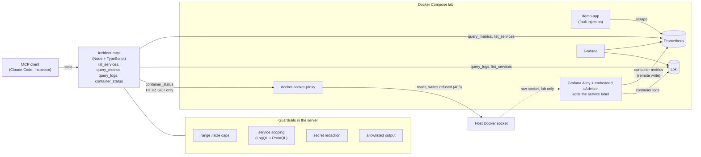

# incident-mcp

[](https://github.com/4klud/incident-mcp/actions/workflows/ci.yml)

A **read-only [Model Context Protocol](https://modelcontextprotocol.io) server** that gives an AI assistant the data it needs to investigate an incident: Prometheus metrics, Loki logs and Docker container state, all joined on one key, the **compose service name**.

It is a learning project and portfolio piece. The interesting part is not the tools themselves but where the safety lives: **in the server, not in the prompt.**

```
Assistant: "demo-app looks unhealthy. What's going on?"
   → container_status   restartCount: 1, state: running          (it crashed and restarted)
   → query_logs         {service="demo-app"} | json | status="500"  (the errors behind it)
   → query_metrics      sum(rate(http_requests_total{service="demo-app"}[1m])) by (status)
```

## Architecture



**Join key.** The `service` label is derived from Docker's own `com.docker.compose.service` label inside Alloy and Prometheus relabeling. Apps never self-report it, so it can't drift or be spoofed by application code.

Layers (`src/`):

| Path | Role |
|---|---|
| `clients/` | Plain HTTP wrappers for Prometheus, Loki and Docker. No MCP knowledge, easy to mock. |
| `tools/` | MCP tool definitions: Zod input schemas, guardrails, output shaping. |
| `guardrails.ts` | Shared guardrails: LogQL and PromQL service-scope checks, and secret redaction. |
| `config.ts` | Backend URLs from environment variables. |
| `index.ts` | Registers the tools and starts the stdio transport. |

## Tools

All four tools are read-only and carry `readOnlyHint: true`.

| Tool | Returns | Limits |
|---|---|---|
| `list_services` | Service names visible in Prometheus and/or Loki, and which signals each has | none needed |
| `query_metrics` | A PromQL range query result | 6 h max range, 5 s min step, 2000 points per series, **every selector must be scoped to a service** |
| `query_logs` | A LogQL range query result; secrets redacted | 6 h max range, 500 lines, **query must be scoped to a service** |
| `container_status` | State, health, restart count, OOM-killed flag, exit code and start/finish times for a service's containers, including stopped ones | 10 containers per service, allowlisted fields only |

## Guardrails

These are enforced in code and covered by unit tests. They do not depend on the model behaving.

- **Bounded queries.** Time range, step and result size are capped before a request is sent.
- **Mandatory service scoping for logs and metrics.** `query_logs` parses the LogQL stream selectors (it does not just search for the text `service=`). *Every* selector must contain `service="<name>"` with a plain `=`. `{other_service="x"}`, `{service=~".+"}`, `{service=""}`, a scoped selector hidden in a comment, or one scoped plus one unscoped selector are all rejected. Anything it can't parse is rejected too (fail closed). `query_metrics` applies the same rule to PromQL, where it also has to reject bare metric names (`up`, `rate(x[1m])`), since PromQL needs no braces to select a metric.
- **Allowlisted output.** `container_status` builds its result field by field. The container's environment variables are never copied, so they cannot leak.
- **Secret redaction.** Log lines, log labels and the container error text pass through `redactSecrets`: `password=…`, `token=…`, `Authorization: Bearer …`, credentials in URLs, AWS keys, JWTs, GitHub/Slack/`sk-` tokens and private-key blocks. Patterns are length-bounded so a hostile 200 KB log line cannot make them backtrack, and a test checks that.
- **Read-only Docker access.** The server never touches the raw Docker socket. It talks to [docker-socket-proxy](https://github.com/Tecnativa/docker-socket-proxy) with only `CONTAINERS=1`, so writes are refused: a `POST` to stop a container returns `403`. (`readOnlyHint` is only a hint to clients; the proxy is the actual guarantee.)

### Limitations

Worth knowing, and worth being honest about:

- **Redaction is best-effort, not data-loss prevention.** It cannot catch a secret with no marker ("logged in with hunter2"), unusual formats, or the body lines of a multi-line private key when they arrive as separate log lines. It errs toward over-redacting (`tokens_used=5` becomes `tokens_used=[REDACTED]`). These cases are pinned down as tests.
- **The PromQL scope check is a token scanner, not a full parser.** It fails closed, so some valid queries are rejected, e.g. single-quoted label values (`service='a'`). That gap is pinned as a test.
- **stdio transport only**, and no authentication. It is meant to run locally next to the client.
- **Lab only:** Grafana runs with anonymous admin, and Alloy runs `privileged` with the Docker socket mounted. Don't copy those settings anywhere real.

## Quick start

Requires Node 20+ and Docker.

```bash
# 1. Start the lab (Prometheus, Loki, Grafana, Alloy, docker-socket-proxy, demo app)
docker compose -f lab/docker-compose.yml up -d

# 2. Build the server
npm install
npm run build

# 3. Explore it with the MCP Inspector (no LLM needed)
npx @modelcontextprotocol/inspector node dist/index.js

# 4. Or register it with Claude Code
claude mcp add incident -- node /absolute/path/to/incident-mcp/dist/index.js
```

Configuration (environment variables, all optional):

| Variable | Default | Purpose |
|---|---|---|
| `PROMETHEUS_URL` | `http://localhost:9091` | Prometheus base URL |
| `LOKI_URL` | `http://localhost:3100` | Loki base URL |
| `DOCKER_PROXY_URL` | `http://127.0.0.1:2375` | docker-socket-proxy (never the raw socket) |

Lab ports: demo app `9090`, Prometheus `9091`, Loki `3100`, Grafana `3000`, Alloy `12345`, docker-socket-proxy `127.0.0.1:2375`. Image versions are pinned.

## Two-minute demo

The demo app is an API with no web page (`GET /` returns "Cannot GET /", which is expected). It has `/ok`, `/metrics` and built-in fault injection (`/error`, `/slow`, `/cpu`, `/crash`). With the lab running and the server registered (or the Inspector open):

```bash
# Generate some trouble
for i in $(seq 1 20); do curl -s "localhost:9090/error?rate=1" >/dev/null; curl -s "localhost:9090/slow?ms=300" >/dev/null; done
curl -s localhost:9090/crash     # the process dies; Docker restarts the container
```

Then, in the Inspector or by asking an assistant:

1. `list_services`: every compose service appears, with metrics and logs.
2. `container_status` with `service: "demo-app"`: `restartCount` has gone up.
3. `query_logs` with `{service="demo-app"} | json | status="500"`: the simulated errors.
4. `query_metrics` with `sum(rate(http_requests_total{service="demo-app"}[1m])) by (status)`: the request rate by status code.
5. Try to break a guardrail: `query_logs` with `{other_service="x"}`, or a range longer than 6 hours. Both are rejected with a clear error.

A longer walkthrough, with a query cheat sheet and how to use the Prometheus, Alloy and Grafana UIs, is in [DEMO.md](DEMO.md).

## Development

```bash
npm test -- --run     # Vitest; clients are mocked
npm run build         # tsc → dist/
```

Unit tests mock the backend clients, so they run without the lab. The guardrail tests cover the LogQL and PromQL scanners (good and bad queries, fail-closed cases), every redaction rule, idempotence, the known gaps, and adversarial inputs for regex backtracking.

## Notes from building it

- Container metrics come from **Alloy's embedded cAdvisor exporter**, not a standalone cAdvisor. On Docker Desktop the standalone one only produced cgroup IDs with no names or labels, so the `service` label had nothing to attach to. The embedded exporter resolves them through the Docker API.
- Redaction patterns are the kind of code where an unbounded `*` is a denial-of-service bug. The first version of two patterns went quadratic on repeated input (seconds for a 200 KB line); bounding them fixed it.

## License

See [LICENSE](LICENSE).
